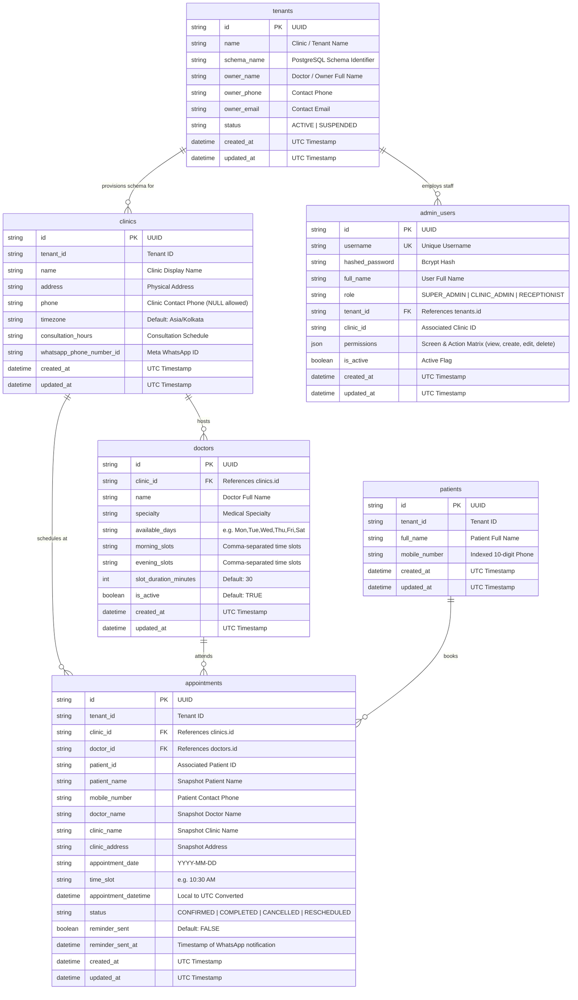
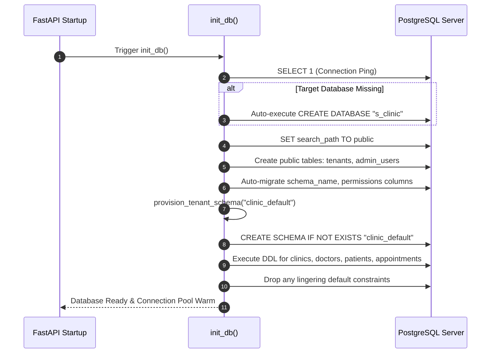
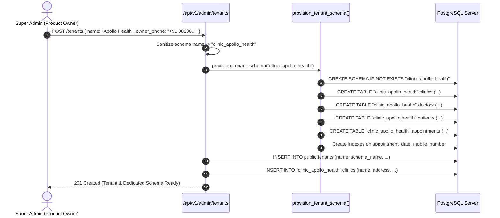
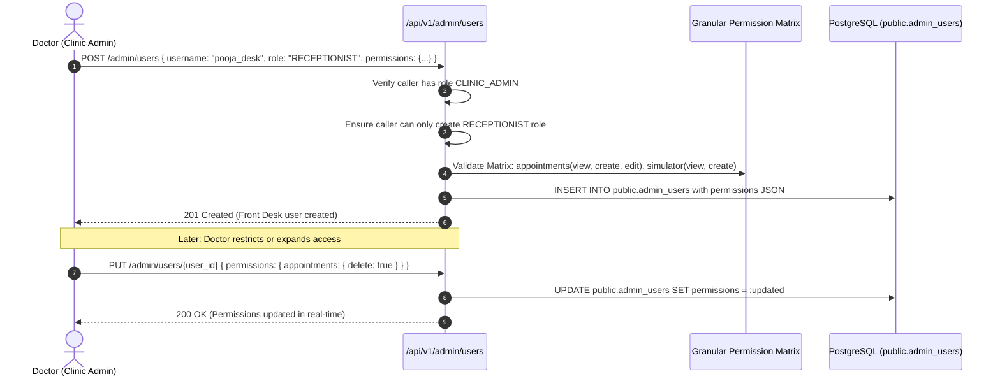
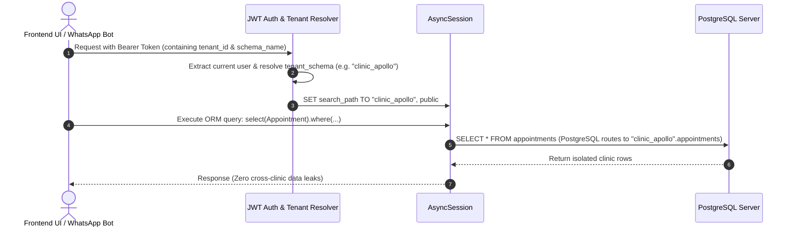
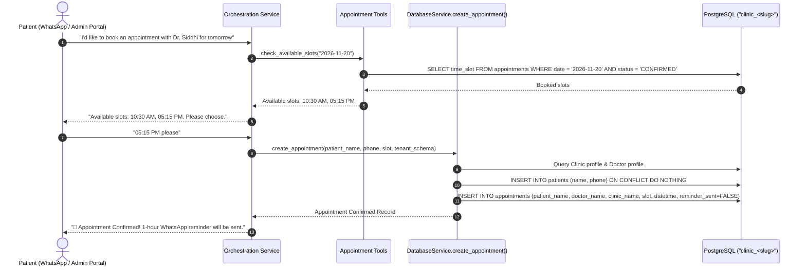
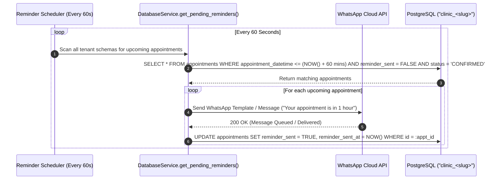

# Database Architecture & Workflow Guide (`db_workflow.md`)
### Siddhi Patient-Doctor Assistant — Schema-Per-Clinic Multi-Tenant Architecture

---

## 1. Executive Summary & Core Principles

The **Siddhi Patient-Doctor Assistant** platform is built on an enterprise-grade **Schema-Per-Clinic Multi-Tenant Architecture** in PostgreSQL. In this design:
- **Clinic = Tenant**: Each registered clinic (doctor / medical practice) operates as an independent tenant.
- **Physical Schema Isolation**: Every clinic receives its own dedicated PostgreSQL schema (e.g., `clinic_default`, `clinic_apollo`, `clinic_citycare`).
- **No Hardcoded Domain Defaults**: Database table definitions (DDL) and SQLAlchemy models contain **zero hardcoded domain defaults** (such as sample doctor names, dummy phone numbers, or fixed clinic addresses). Columns are generic, normalized, and strictly populated through explicit runtime API calls or verified seed services.
- **Granular Screen & Action RBAC**: User permissions are stored as a JSON action matrix (`view`, `create`, `edit`, `delete`) per screen, allowing Doctors (Clinic Admins) to delegate restricted access to Front Desk receptionists.

---

## 2. Schema Hierarchy & Separation

The database is divided into two distinct logical tiers:

```
┌────────────────────────────────────────────────────────────────────────┐
│                        PostgreSQL Database: s_clinic                    │
└────────────────────────────────────┬───────────────────────────────────┘
                                     │
           ┌─────────────────────────┴─────────────────────────┐
           ▼                                                   ▼
┌─────────────────────────────────┐         ┌─────────────────────────────────┐
│     Control Plane: `public`     │         │ Tenant Data Plane: `clinic_*`   │
├─────────────────────────────────┤         ├─────────────────────────────────┤
│ • tenants (Clinic Registry)     │         │ • clinics    (Clinic Profile)   │
│ • admin_users (Global & Tenant) │         │ • doctors    (Doctor Profiles)  │
│                                 │         │ • patients   (Patient Master)   │
│                                 │         │ • appointments (Bookings & Log) │
└─────────────────────────────────┘         └─────────────────────────────────┘
                                                           ▲
                                                           │ (Repeated per clinic)
                                            ┌──────────────┴──────────────────┐
                                            │ • clinic_default                │
                                            │ • clinic_apollo                 │
                                            │ • clinic_care_plus              │
                                            └─────────────────────────────────┘
```

### 2.1 Control Plane: Shared `public` Schema
- **`tenants` Table**: System catalog of all registered clinics, their designated schema names, owner contact information, and operational status.
- **`admin_users` Table**: Master authentication table for all platform users across roles (`SUPER_ADMIN`, `CLINIC_ADMIN`, `RECEPTIONIST`), storing bcrypt password hashes and granular screen action permission matrices.

### 2.2 Data Plane: Isolated Clinic Schemas (`clinic_<slug>`)
- Every clinic has an isolated namespace containing:
  - **`clinics`**: Metadata, consultation hours, clinic address, and WhatsApp Business API credentials.
  - **`doctors`**: Working days, morning/evening time slot lists, slot durations, and active statuses.
  - **`patients`**: Master patient registry for that specific clinic.
  - **`appointments`**: Confirmed bookings, appointment timestamps, doctor/clinic snapshots, and 1-hour WhatsApp reminder tracking.

---

## 3. Entity-Relationship Diagram (Mermaid ERD)



---

## 4. Database Table Specifications & Clean Column Design

All hardcoded domain values have been removed from table DDL. Initial seed values are only injected dynamically via `database_service.py` if explicitly requested.

| Schema | Table | Column | Type | Constraints | Description |
| :--- | :--- | :--- | :--- | :--- | :--- |
| `public` | `tenants` | `id` | `VARCHAR(36)` | `PRIMARY KEY` | UUID string |
| `public` | `tenants` | `name` | `VARCHAR(100)` | `NOT NULL` | Clinic business name |
| `public` | `tenants` | `schema_name` | `VARCHAR(63)` | `NOT NULL` | Schema name (e.g. `clinic_apollo`) |
| `public` | `tenants` | `owner_name` | `VARCHAR(100)` | `NULL` | Clinic doctor / owner name |
| `public` | `tenants` | `status` | `VARCHAR(20)` | `DEFAULT 'ACTIVE'` | ACTIVE or SUSPENDED |
| `public` | `admin_users` | `id` | `VARCHAR(36)` | `PRIMARY KEY` | UUID string |
| `public` | `admin_users` | `username` | `VARCHAR(50)` | `UNIQUE, NOT NULL` | Login username |
| `public` | `admin_users` | `role` | `VARCHAR(30)` | `NOT NULL` | `SUPER_ADMIN`, `CLINIC_ADMIN`, `RECEPTIONIST` |
| `public` | `admin_users` | `permissions` | `JSON` | `NULL` | Action matrix per screen |
| `clinic_*` | `clinics` | `id` | `VARCHAR(36)` | `PRIMARY KEY` | UUID string |
| `clinic_*` | `clinics` | `name` | `VARCHAR(150)` | `NOT NULL` | Clean clinic name |
| `clinic_*` | `clinics` | `phone` | `VARCHAR(30)` | `NULL` | Clean contact phone |
| `clinic_*` | `clinics` | `consultation_hours`| `VARCHAR(255)` | `NULL` | Working hours schedule |
| `clinic_*` | `doctors` | `id` | `VARCHAR(36)` | `PRIMARY KEY` | UUID string |
| `clinic_*` | `doctors` | `clinic_id` | `VARCHAR(36)` | `FK -> clinics.id` | Cascading clinic reference |
| `clinic_*` | `doctors` | `name` | `VARCHAR(100)` | `NOT NULL` | Doctor's full name |
| `clinic_*` | `doctors` | `specialty` | `VARCHAR(100)` | `NOT NULL` | Specialty (e.g., General Physician) |
| `clinic_*` | `doctors` | `available_days`| `VARCHAR(100)` | `NOT NULL` | Available days string |
| `clinic_*` | `doctors` | `morning_slots` | `VARCHAR(255)` | `NULL` | Available morning slots |
| `clinic_*` | `doctors` | `evening_slots` | `VARCHAR(255)` | `NULL` | Available evening slots |
| `clinic_*` | `patients`| `id` | `VARCHAR(36)` | `PRIMARY KEY` | UUID string |
| `clinic_*` | `patients`| `mobile_number` | `VARCHAR(20)` | `NOT NULL, INDEX` | 10-digit mobile number |
| `clinic_*` | `appointments` | `id` | `VARCHAR(36)` | `PRIMARY KEY` | UUID string |
| `clinic_*` | `appointments` | `doctor_name` | `VARCHAR(100)` | `NOT NULL` | Snapshot of doctor name at booking |
| `clinic_*` | `appointments` | `clinic_name` | `VARCHAR(150)` | `NOT NULL` | Snapshot of clinic name at booking |
| `clinic_*` | `appointments` | `appointment_datetime` | `TIMESTAMP WITH TZ` | `NOT NULL, INDEX`| Standardized UTC slot timestamp |
| `clinic_*` | `appointments` | `reminder_sent`| `BOOLEAN` | `DEFAULT FALSE, INDEX`| 1-Hour WhatsApp reminder sent flag |

---

## 5. End-to-End System Workflows

### Workflow 1: Application Boot & Database Initialization


---

### Workflow 2: Clinic Onboarding & Isolated Schema Provisioning


---

### Workflow 3: Front Desk User Creation & Granular Permissions Assignment
Doctors (Clinic Admins) create their front desk staff and assign screen and action permissions:



**Permission Matrix Schema:**
```json
{
  "appointments": { "view": true, "create": true, "edit": true, "delete": false },
  "patients":     { "view": true, "create": true, "edit": true, "delete": false },
  "doctors":      { "view": true, "create": false, "edit": false, "delete": false },
  "simulator":    { "view": true, "create": true, "edit": false, "delete": false },
  "analytics":    { "view": false, "create": false, "edit": false, "delete": false },
  "users":        { "view": false, "create": false, "edit": false, "delete": false }
}
```

---

### Workflow 4: Tenant Request Routing via PostgreSQL `search_path`
All standard database sessions set `search_path` to the authenticated user's clinic schema. No queries require manual schema prefixing:



---

### Workflow 5: Patient Appointment Booking & Clinical Data Flow


---

### Workflow 6: Automated 1-Hour WhatsApp Reminder Background Engine


---

## 6. Verification & Inspection Cheat Sheet

### View All Provisioned Tenant Schemas
```sql
SELECT schema_name 
FROM information_schema.schemata 
WHERE schema_name LIKE 'clinic_%' 
ORDER BY schema_name;
```

### Verify Table Isolation in a Dedicated Tenant Schema
```sql
SELECT table_schema, table_name 
FROM information_schema.tables 
WHERE table_schema = 'clinic_apollo' 
ORDER BY table_name;
```

### Verify Clean Column Defaults (No Hardcoded Domain Strings)
```sql
SELECT table_schema, table_name, column_name, column_default
FROM information_schema.columns
WHERE table_schema = 'clinic_default'
  AND column_name IN (
    'phone', 'consultation_hours', 'specialty', 
    'available_days', 'morning_slots', 'evening_slots', 
    'doctor_name', 'clinic_name', 'clinic_address'
  );
-- All column_default values will return NULL (no hardcoded strings in DDL)
```

### Inspect Granular Permissions of Front Desk Users
```sql
SELECT username, role, full_name, permissions 
FROM public.admin_users 
WHERE role = 'RECEPTIONIST';
```

---

## 7. Summary of Completed Improvements

1. **Removed Domain Defaults**: Hardcoded values (`Dr. Siddhi Patel`, `Dr. Siddhi Patel's Clinic`, `+91 98765 00000`, `General Physician`, `Mon,Tue,Wed,Thu,Fri,Sat`, etc.) have been completely removed from SQLAlchemy models, Pydantic schemas, and PostgreSQL DDL statements.
2. **Dynamic Runtime Resolution**: All appointments dynamically query doctor and clinic profiles, capturing snapshot fields accurately at booking time.
3. **Database Drop Migration**: Existing tables in `clinic_default` and `public` were automatically updated to drop any lingering default constraints.
4. **Complete Multi-Tenant Documentation**: This comprehensive guide outlines the entity relationships, lifecycle sequences, schema isolation patterns, and verification queries.
